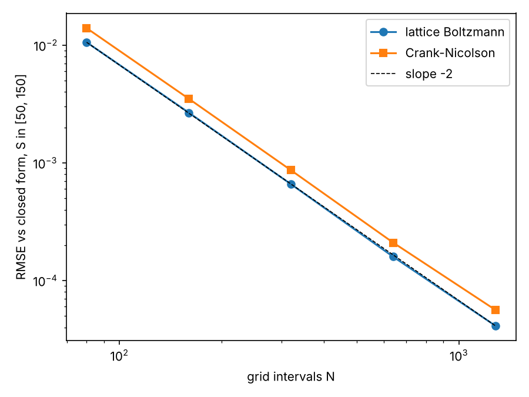

# Black-Scholes with the lattice Boltzmann method

Prices a European call by turning the Black-Scholes PDE into the heat equation and solving it with a D1Q3 lattice Boltzmann scheme. Crank-Nicolson on the same grid and the closed-form price are used as benchmarks.

## Installing and running

```
conda env create -f environment.yml
conda activate bslbm
pytest
flake8 .
```

An example:

```python
from bslbm import lbm, to_price

x, u, steps = lbm(640)
S, V = to_price(x, u)
```

`python run.py` prints the convergence table and saves it, with a plot, in `results/`.

## Method

### Notation

| Symbol | Meaning |
|---|---|
| $S$, $K$ | spot price, strike |
| $r$, $\sigma$ | risk-free rate, volatility |
| $t$, $T$ | current time, expiry (years) |
| $V(S, t)$ | call price |
| $x = \ln(S/K)$ | log-moneyness |
| $\tau = \tfrac{\sigma^2}{2}(T - t)$ | scaled time to expiry |
| $k = 2r/\sigma^2$ | rate relative to variance |
| $\alpha$, $\beta$ | exponents that remove the drift and decay terms |
| $u(x, \tau)$ | transformed price, solves the heat equation |
| $f_i$, $c_i$, $w_i$ | LBM populations, lattice velocities, weights |
| $\tau_r$ | LBM relaxation time (not the same as $\tau$) |
| $\Delta x$, $\Delta\tau$, $N$ | grid spacing, time step, number of grid intervals |
| $\lambda = \Delta\tau/\Delta x^2$ | Crank-Nicolson mesh ratio |

### From Black-Scholes to the heat equation

The price $V(S, t)$ of a European call satisfies

```math
\frac{\partial V}{\partial t} + \frac{1}{2}\sigma^2 S^2 \frac{\partial^2 V}{\partial S^2} + rS\frac{\partial V}{\partial S} - rV = 0,
\qquad V(S, T) = \max(S - K, 0).
```

This is a diffusion equation in disguise, with three things in the way: the coefficients depend on $S$, time runs backwards from a condition at expiry, and there is a drift term ($\partial V/\partial S$) and a decay term ($-rV$). Each substitution below removes one of them.

**Step 1: log price and reversed, scaled time.** Let

```math
S = Ke^{x}, \qquad t = T - \frac{2\tau}{\sigma^2}, \qquad V(S, t) = K\,v(x, \tau).
```

Using $x = \ln(S/K)$ removes the $S$ in the coefficients, because

```math
S\frac{\partial V}{\partial S} = K\frac{\partial v}{\partial x}, \qquad
S^2\frac{\partial^2 V}{\partial S^2} = K\left(\frac{\partial^2 v}{\partial x^2} - \frac{\partial v}{\partial x}\right), \qquad
\frac{\partial V}{\partial t} = -\frac{\sigma^2}{2}K\frac{\partial v}{\partial \tau}.
```

Here $\tau = \tfrac{\sigma^2}{2}(T - t)$ is the time to expiry, scaled so the diffusion coefficient comes out as 1. It runs forwards from $\tau = 0$ at expiry, so the payoff becomes an initial condition. Substituting and dividing by $K\sigma^2/2$ gives

```math
\frac{\partial v}{\partial \tau} = \frac{\partial^2 v}{\partial x^2} + (k - 1)\frac{\partial v}{\partial x} - kv,
\qquad k = \frac{2r}{\sigma^2}.
```

All the parameters now sit in the single number $k$: the ratio of the interest rate to the variance.

**Step 2: remove the drift and decay terms.** Try

```math
v(x, \tau) = e^{\alpha x + \beta \tau}u(x, \tau).
```

Then

```math
\frac{\partial v}{\partial \tau} = e^{\alpha x + \beta\tau}\left(\beta u + \frac{\partial u}{\partial \tau}\right), \qquad
\frac{\partial v}{\partial x} = e^{\alpha x + \beta\tau}\left(\alpha u + \frac{\partial u}{\partial x}\right),
```

```math
\frac{\partial^2 v}{\partial x^2} = e^{\alpha x + \beta\tau}\left(\alpha^2 u + 2\alpha\frac{\partial u}{\partial x} + \frac{\partial^2 u}{\partial x^2}\right).
```

Substituting and cancelling the exponential:

```math
\frac{\partial u}{\partial \tau} = \frac{\partial^2 u}{\partial x^2}
+ \underbrace{\left[2\alpha + (k - 1)\right]}_{\text{drift}}\frac{\partial u}{\partial x}
+ \underbrace{\left[\alpha^2 + (k - 1)\alpha - k - \beta\right]}_{\text{decay}}u.
```

Choose $\alpha$ so the drift term vanishes, then $\beta$ so the decay term vanishes:

```math
\alpha = -\frac{k - 1}{2}, \qquad
\beta = \alpha^2 + (k - 1)\alpha - k = \frac{(k-1)^2}{4} - \frac{(k-1)^2}{2} - k = -\frac{(k + 1)^2}{4}.
```

What is left is the heat equation:

```math
\frac{\partial u}{\partial \tau} = \frac{\partial^2 u}{\partial x^2}, \qquad 0 < \tau \le \frac{\sigma^2 T}{2}.
```

Putting the two steps together, the option price is recovered from $u$ by

```math
V(S, t) = K e^{\alpha x + \beta\tau}u(x, \tau).
```

**Step 3: the payoff becomes the initial condition.** At expiry $\tau = 0$ and $V = \max(Ke^x - K, 0)$, so $v(x, 0) = \max(e^x - 1, 0)$ and

```math
u(x, 0) = e^{-\alpha x}\max(e^x - 1, 0) = \max\left(e^{(k+1)x/2} - e^{(k-1)x/2},\ 0\right).
```

For the example below ($r = 5\%$, $\sigma = 20\%$): $k = 2.5$, $\alpha = -0.75$, $\beta = -3.0625$, and the problem runs to $\tau = 0.02$.

### Boundaries

The grid covers $x \in [-2, 2]$, so $S$ runs from about 13.5 to 739. Far out of the money the call is worthless. Deep in the money it is almost certain to be exercised, so it is worth $S - Ke^{-r(T-t)}$. Since $r(T - t) = k\tau$, this is $v = e^x - e^{-k\tau}$, and multiplying by $e^{-\alpha x - \beta\tau}$ (using $\tfrac{(k+1)^2}{4} - k = \tfrac{(k-1)^2}{4}$) gives:

```math
u(x_{\min}, \tau) = 0, \qquad
u(x_{\max}, \tau) = e^{(k+1)x/2 + (k+1)^2\tau/4} - e^{(k-1)x/2 + (k-1)^2\tau/4}.
```

### Lattice Boltzmann (D1Q3)

Three populations $f_i$ with velocities $c_i \in \{-1, 0, +1\}$ and weights $w_i = \left(\tfrac{1}{6}, \tfrac{2}{3}, \tfrac{1}{6}\right)$. Each step relaxes them towards equilibrium (BGK collision) and streams them one cell:

```math
f_i(x + c_i\Delta x,\ \tau + \Delta\tau) = f_i(x, \tau) - \frac{1}{\tau_r}\left[f_i(x, \tau) - f_i^{\mathrm{eq}}(x, \tau)\right],
\qquad f_i^{\mathrm{eq}} = w_i u, \qquad u = \sum_i f_i.
```

This recovers the diffusion equation with

```math
D = c_s^2\left(\tau_r - \frac{1}{2}\right)\frac{\Delta x^2}{\Delta\tau}, \qquad c_s^2 = \frac{1}{3},
```

so the relaxation time is set to $\tau_r = \tfrac{1}{2} + 3\Delta\tau/\Delta x^2$ to make $D = 1$ exactly. The scheme is explicit, so $\Delta\tau$ has to scale with $\Delta x^2$.

The boundaries use anti-bounce-back, with the wall half a cell outside the last node. A population $f_i^*$ leaving the domain comes back in the opposite direction $\bar{i}$ as

```math
f_{\bar{i}} = -f_i^* + 2 w_i\, u_{\mathrm{wall}}.
```

### Crank-Nicolson

With $\lambda = \Delta\tau / \Delta x^2$, each step solves the tridiagonal system

```math
-\frac{\lambda}{2}u_{j-1}^{n+1} + (1 + \lambda)u_j^{n+1} - \frac{\lambda}{2}u_{j+1}^{n+1}
= \frac{\lambda}{2}u_{j-1}^{n} + (1 - \lambda)u_j^{n} + \frac{\lambda}{2}u_{j+1}^{n}.
```

It is implicit and stable for any $\Delta\tau$.

### Error

Prices are compared with the closed form

```math
C = S\,N(d_1) - Ke^{-rT}N(d_2), \qquad
d_1 = \frac{\ln(S/K) + (r + \sigma^2/2)T}{\sigma\sqrt{T}}, \qquad d_2 = d_1 - \sigma\sqrt{T},
```

using the RMSE over 201 spot prices between 50 and 150:

```math
\mathrm{RMSE} = \sqrt{\frac{1}{201}\sum_{m=1}^{201}\left(V_{\mathrm{num}}(S_m) - C(S_m)\right)^2}.
```

Example: $K = 100$, $r = 5\%$, $\sigma = 20\%$, $T = 1$ year. The closed-form at-the-money price is 10.4506.

## Results

| N | LBM RMSE | LBM steps | CN RMSE | CN steps |
|---|---|---|---|---|
| 80 | 1.06e-02 | 48 | 1.40e-02 | 10 |
| 160 | 2.67e-03 | 193 | 3.51e-03 | 20 |
| 320 | 6.59e-04 | 769 | 8.66e-04 | 40 |
| 640 | 1.60e-04 | 3072 | 2.10e-04 | 80 |
| 1280 | 4.14e-05 | 12288 | 5.64e-05 | 160 |



Both schemes are second order: doubling $N$ cuts the error by about 4. Lattice Boltzmann is about 25% more accurate on the same grid, but because $\Delta\tau \propto \Delta x^2$ it needs far more steps: 3072 at $N = 640$, where Crank-Nicolson takes 80. Crank-Nicolson is the cheaper way to reach a given accuracy. The interest of lattice Boltzmann is that every step is local, so it is simple to parallelise.

## Structure

```
bslbm/transform.py         change of variables, payoff, boundary, closed form
bslbm/lbm.py               D1Q3 lattice Boltzmann solver
bslbm/crank_nicolson.py    Crank-Nicolson solver
run.py                     convergence table and plot
tests/                     pytest tests
```

## References

- F. Black and M. Scholes, "The Pricing of Options and Corporate Liabilities", *Journal of Political Economy* 81(3), 637–654, 1973.
- P. Wilmott, S. Howison and J. Dewynne, *The Mathematics of Financial Derivatives: A Student Introduction*, Cambridge University Press, 1995. Section 5.4 derives the change of variables used here.
- T. Krüger, H. Kusumaatmaja, A. Kuzmin, O. Shardt, G. Silva and E. M. Viggen, *The Lattice Boltzmann Method: Principles and Practice*, Springer, 2017. Covers BGK lattice Boltzmann for advection-diffusion and the bounce-back boundary conditions.
- J. Crank and P. Nicolson, "A practical method for numerical evaluation of solutions of partial differential equations of the heat-conduction type", *Mathematical Proceedings of the Cambridge Philosophical Society* 43(1), 50–67, 1947.
